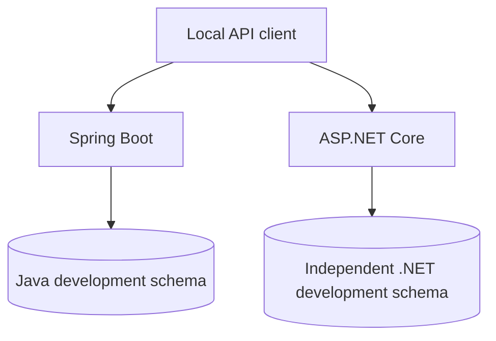
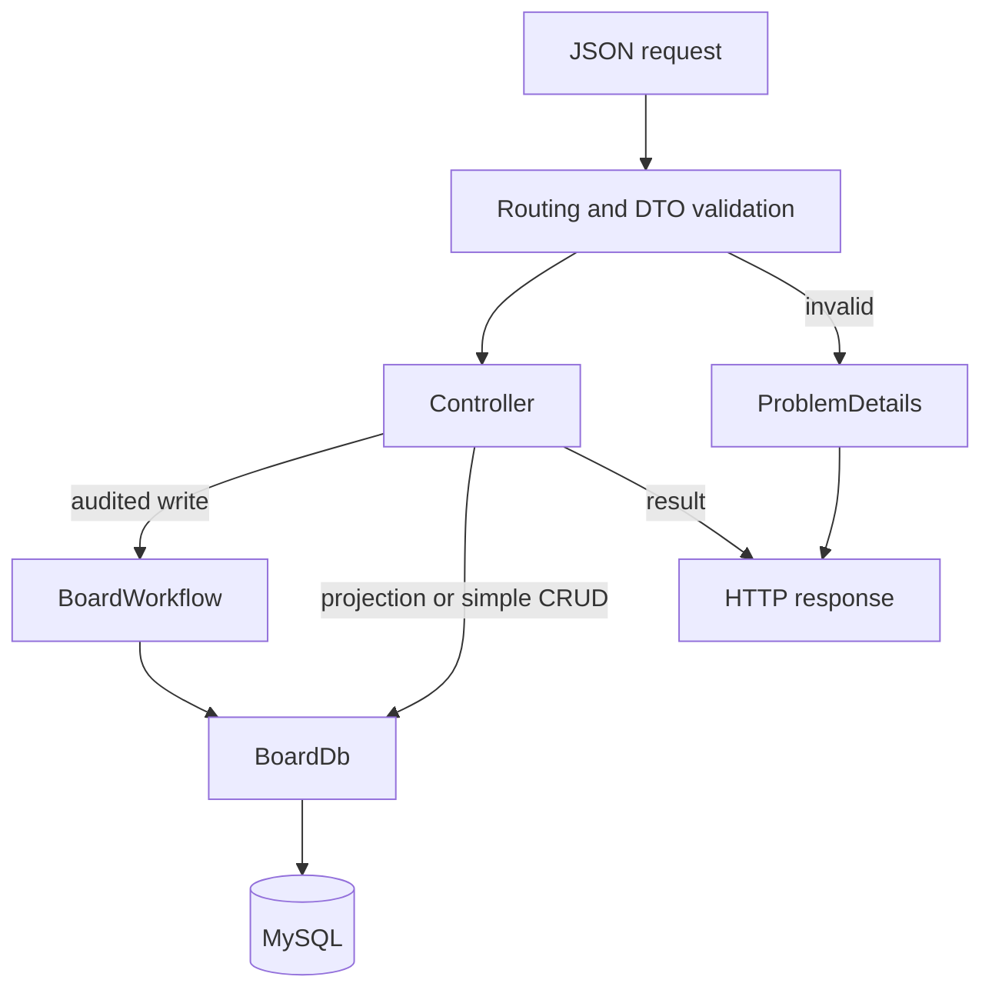
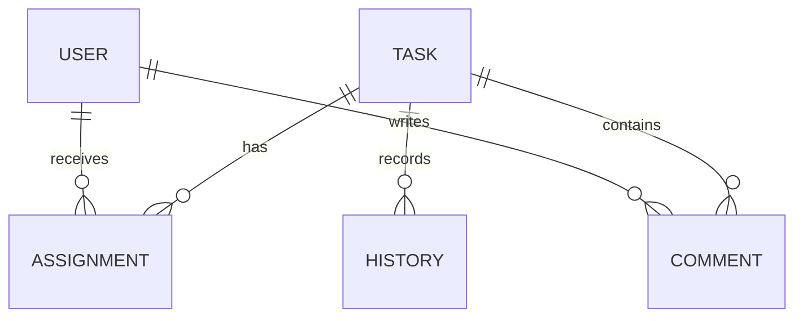

# Task Manager

Task Manager tracks work through TODO, DOING and DONE. Users can share a task, comment on it, and read its change history. This repository contains two independently runnable backends.

| Implementation | Stack | Entry point |
|---|---|---|
| Original | Java 19, Spring Boot 2.7.5, Spring Web, Spring Data JPA, MySQL, Maven | `src/main/java/edu/syr/project/trelloclone/` |
| Alternative | C#, .NET 10 LTS, ASP.NET Core MVC, EF Core 10, Oracle MySQL provider, xUnit | `dotnet/TaskManager.Api/Program.cs` |

## Architecture







## Features and API

Create, read, edit and delete tasks and users. Search users by name, manage assignments, add and delete comments, list assigned users or tasks, and inspect task history. A user can comment before assignment. A task can move directly between any two valid states. Repeating the same edit leaves its timestamp and history intact.

| Operation | Example request | Example response |
|---|---|---|
| Create a user | `POST /api/users` with `{"name":"Alex"}` | 201 `{"id":1,"name":"Alex"}` |
| Create a task | `POST /api/tasks` with `{"description":"Review API"}` | 201 with ID, description, state, createdUtc and modifiedUtc |
| Change its state | `PUT /api/tasks/2/state` with `{"state":"DONE"}` | 200 with updated task |
| Assign a user | `POST /api/tasks/2/assignees/1` | 201 with taskId, description, userId and name |
| Add a comment | `POST /api/tasks/2/comments` with `{"userId":1,"comment":"Reviewed"}` | 201 `{"id":3,"userId":1,"taskId":2,"comment":"Reviewed"}` |
| Read history | `GET /api/tasks/2/history?limit=10` | 200 with an ordered array of events |

IDs above are illustrative. The full route inventory covers both implementations. [API reference](docs/api-reference.md)

## Source map

- `src/main`, `src/test`, `pom.xml` and the Maven wrapper contain the original application.
- `dotnet/TaskManager.Api/Controllers` defines HTTP contracts. `Contracts.cs` holds DTOs, validation and projections.
- `Services/BoardWorkflow.cs` coordinates mutations with history. `Persistence/BoardDb.cs` defines entities, keys and mappings within the API project.
- `dotnet/TaskManager.Tests` exercises workflows with relational SQLite. [Java-to-.NET guide and interview walkthrough](docs/java-to-dotnet.md)

## Run the Java backend locally

Use JDK 19, the supplied wrapper, and a dedicated local MySQL schema called `team10`. Some native queries hardcode that schema. Override the checked-in Spring datasource settings before running either command. Hibernate uses `ddl-auto=update`.

```bash
export SPRING_DATASOURCE_URL='jdbc:mysql://localhost:3306/team10'
export SPRING_DATASOURCE_USERNAME='<local-java-user>'
export SPRING_DATASOURCE_PASSWORD='<local-password>'
bash mvnw test
bash mvnw spring-boot:run
```

## Run the ASP.NET Core backend locally

Use the .NET 10 SDK and a separate, empty local MySQL 8 database such as `taskmanager_dotnet_dev`. Give its development account privileges only on that schema. The .NET model uses generated numeric keys, a composite assignment key, required text, string states and cascading foreign keys. Java uses sequence-generated IDs including a separate assignment ID. There is no shared-schema or data migration.

From the repository root, configure a local connection and install the matching EF CLI if needed.

```bash
cd dotnet
export ConnectionStrings__TaskManager='Server=localhost;Database=taskmanager_dotnet_dev;User ID=<local-dotnet-user>;Password=<local-password>'
export ASPNETCORE_ENVIRONMENT=Development
dotnet tool install --global dotnet-ef --version 10.0.12
dotnet restore TaskManager.slnx
dotnet build TaskManager.slnx
dotnet test TaskManager.slnx
```

**Migration workflow.** The initial provider-generated migration and snapshot still need to be generated and reviewed. Run the first command once, inspect the migration and SQL for keys, indexes and cascading deletes, then commit the migration and snapshot together. Once committed, subsequent checkouts use that baseline. Apply only to the isolated local database.

```bash
dotnet ef migrations add InitialBoard --project TaskManager.Api
dotnet ef migrations script --project TaskManager.Api
dotnet ef database update --project TaskManager.Api
dotnet run --project TaskManager.Api -- --urls http://localhost:5080
```

Development OpenAPI JSON is available at `/openapi/v1.json`. The application never applies migrations on startup. The SQLite test fixture creates its own in-memory schema and needs no connection string.

## Engineering decisions and status

Spring controllers use services and JPA repositories. ASP.NET Core controllers receive scoped dependencies through constructors. EF Core translates DTO projections into SQL and groups tracked writes in a unit of work. A separate application service handles operations that must also write history. Task edits use an optimistic concurrency token. Two simultaneous assignments are constrained by a database key. UTC timestamps describe event time, and history omits comment bodies.

Source and endpoint mappings were reviewed statically. The SDK was unavailable during implementation. Build, tests, generated SQL, database migrations and runtime HTTP behavior await execution. There is no frontend in this checkout, authentication, authorization, deployment, or configured cross-origin browser access. The history table cascades on task deletion and serves as a task activity feed.

Useful follow-ups include committing a reviewed initial migration, exercising MySQL-specific behavior in integration tests, and adding authorization before exposing user data to multiple clients.
